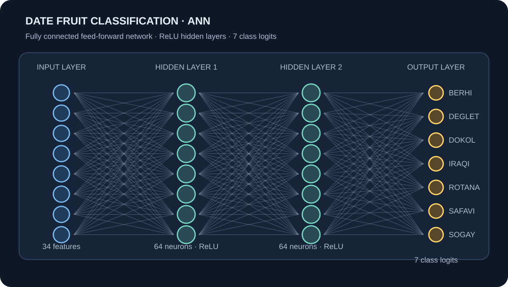

# Date Fruit Classification with an Artificial Neural Network

A reproducible multi-class classification project built with **PyTorch**. It uses a feed-forward Artificial Neural Network to identify seven date-fruit varieties from 34 numerical measurements describing fruit geometry, shape, colour, and texture.

## Project overview

The goal is to learn a mapping from measured fruit properties to one of seven date-fruit categories. The original notebook is retained as a learning reference, while the modular implementation adds a reproducible training workflow, stratified data splitting, validation-based checkpoint selection, held-out evaluation, and unit tests.

## Dataset

The included dataset contains **898 samples**, **34 numeric input features**, and one target column (`Class`). The supplied CSV has no missing values.

| Class | Description |
|---|---|
| BERHI | Date-fruit class label |
| DEGLET | Date-fruit class label |
| DOKOL | Date-fruit class label |
| IRAQI | Date-fruit class label |
| ROTANA | Date-fruit class label |
| SAFAVI | Date-fruit class label |
| SOGAY | Date-fruit class label |

The classes are not equally represented, so the modular pipeline uses stratified splits to retain class proportions.

## ANN architecture

The network follows the architecture in the supplied notebook:

```text
34 input features
       ↓
Linear(34, 64) + ReLU
       ↓
Linear(64, 64) + ReLU
       ↓
Linear(64, 7)  → class logits
```

**Training configuration:** PyTorch, CrossEntropyLoss, Adam, batch size 32, learning rate 0.001, 100 epochs, and random seed 42.

## Repository structure

```text
date-fruit-classification-ann/
├── data/
│   ├── DateFruit_Dataset.csv
│   └── README.md
├── notebooks/
│   ├── ANN_Classification_original.ipynb
│   └── README.md
├── src/
│   ├── __init__.py
│   ├── data.py
│   ├── model.py
│   ├── train.py
│   └── evaluate.py
├── tests/
│   ├── conftest.py
│   └── test_model.py
├── models/                 # generated checkpoints and preprocessors
├── results/                # generated metrics, history, and plots
├── .github/workflows/ci.yml
├── requirements.txt
├── .gitignore
└── LICENSE
```

## Setup

Python 3.10 or newer is recommended.

```bash
git clone https://github.com/chandusriii/date-fruit-classification-ann.git
cd date-fruit-classification-ann

python -m venv .venv
# Windows PowerShell:
.venv\Scripts\Activate.ps1
# macOS/Linux:
# source .venv/bin/activate

python -m pip install --upgrade pip
pip install -r requirements.txt
```

## Train

Run from the repository root:

```bash
python -m src.train
```

Optional configuration:

```bash
python -m src.train --epochs 100 --batch-size 32 --learning-rate 0.001 --seed 42
```

The pipeline validates the input schema and values, label-encodes the target, creates stratified 70/15/15 train/validation/test partitions, and fits `StandardScaler` on training features only. The best checkpoint is selected by validation accuracy; the test set is not used for model selection.

Generated artifacts:

- `models/best_model.pt` — best validation checkpoint and feature/class metadata.
- `models/scaler.joblib` — fitted training-feature scaler.
- `models/label_encoder.joblib` — fitted class encoder.
- `results/training_history.csv` — per-epoch training and validation metrics.
- `results/training_summary.json` — split details and best validation epoch.
- `results/loss_curve.png` — training and validation loss plot.

## Evaluate

After training:

```bash
python -m src.evaluate
```

Evaluation uses the reproducible held-out test partition and the saved preprocessing artifacts. It reports accuracy, macro precision, macro recall, macro F1, per-class classification metrics, and a confusion matrix in `results/test_metrics.json`.

## Verified baseline results

Using the included dataset with the configuration above:

| Metric | Held-out test result |
|---|---:|
| Accuracy | **93.33%** |
| Macro precision | 92.05% |
| Macro recall | 91.30% |
| Macro F1-score | 91.43% |
| Best validation accuracy | 94.81% |
| Best checkpoint epoch | 26 |

The test partition contains 135 samples. These results are a baseline for the specified split and seed; performance may vary with dataset changes, random seeds, or dependency versions.

## Tests and continuous integration

Run tests locally:

```bash
python -m compileall -q src tests
pytest -q
```

GitHub Actions is configured in `.github/workflows/ci.yml`. It runs compilation, unit tests, and dataset/preprocessing validation for Python 3.10, 3.11, and 3.12 on pushes and pull requests to `main`.

## Original notebook

`notebooks/ANN_Classification_original.ipynb` preserves the supplied 21-cell notebook. Its original approach uses an 80/20 train/test split, `LabelEncoder`, `StandardScaler`, a 34 → 64 → 64 → 7 network, `CrossEntropyLoss`, Adam, batch size 32, and 100 training epochs. The modular pipeline preserves the network design while adding stratification, a separate validation set, best-checkpoint saving, and detailed test metrics.

## Limitations and future work

This is an educational ANN baseline for tabular features, not an image classifier. Potential next steps include comparing against SVM, Random Forest, and gradient boosting; hyperparameter tuning; class-wise error analysis; and testing calibration and generalization on additional samples.

## License

MIT License. See [LICENSE](LICENSE).

## Detailed neural network architecture

<p align="center">
  
</p>

The diagram above visualizes the implemented PyTorch network. The schematic displays selected representative neurons in the wide feature and hidden layers; the layer dimensions are shown explicitly.

